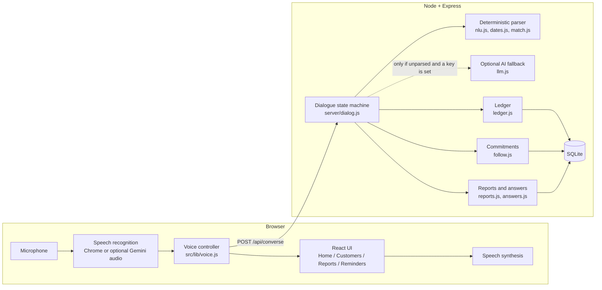

# Architecture

Khata Bol is one Node service. It serves a React single-page app and a JSON API from the same origin, and stores everything in one SQLite database.

## Principles

1. **The AI never writes money.** The parser is deterministic and works with no key. An optional AI call can only suggest an interpretation of one sentence, and that suggestion still has to be read back and confirmed before anything is saved.
2. **Nothing is saved without an explicit yes.** Every pending entry has an id (`pid`). A "haan" carries that id, so a stale or duplicated answer can never approve a different entry.
3. **Uncertain means ask.** Ambiguous names, amounts, dates and directions return a clarification, never a guess.
4. **Money is integer paise.** No floats anywhere in the money path.
5. **Records are immutable.** Mistakes are fixed by a linked reversal row, never by editing or deleting.

## Data model

| Table | Purpose |
|---|---|
| `shops` | One per visitor session. Holds the shop name, the owner name and a demo flag. |
| `customers` | Belong to a shop. Names are 1 to 60 characters. |
| `transactions` | The ledger. `credit`, `payment` and `reversal` rows with a signed `delta_paise`. Database triggers block updates and, outside demo shops, deletes. `idempotency_key` is UNIQUE; one reversal per entry is enforced by a partial unique index. |
| `commitments` | Promised payment dates, which double as reminders: due date, optional time, optional expected amount, priority, note, status. They never change a balance. |
| `commitment_history` | Every create, reschedule, priority change, completion and cancellation. |
| `notification_deliveries` | One row per `(commitment, fire time, channel)`. A UNIQUE constraint means re-running a check can never deliver the same notice twice. |
| `conversations` | The dialogue state for a session, so an unfinished entry survives a page refresh. |
| `audit_events` | A log of significant events, scoped to a shop. |

A customer's balance is always `SUM(delta_paise)` of their transactions. It is computed, never stored.

## Dialogue state machine

`server/dialog.js` keeps one conversation per session with three states: `idle`, `awaiting_clarification` and `awaiting_confirmation`. A pending item can be an entry, a reversal, a balance question, a new customer or a reminder change. Pending items expire after five minutes. A per-session lock means one request runs at a time. Context words such as "iski", "isko" and "ab" refer to the customer or reminder last discussed, and a new full command naming a different customer starts a fresh draft instead of silently reusing the old one.

## Dates and reminders

All dates are resolved in Asia/Kolkata using UTC arithmetic, so month and year boundaries are exact. Ambiguous phrases ("next Friday", "Friday" said on a Friday, "nau baje" with no morning or evening) return options instead of a guess. Past dates are refused. Reminders are delivered in-app while the app is open; there is no background scheduler, and the delivery table is designed so a future always-on scheduler can reuse it without duplicates.

## Sessions and isolation

There are no accounts. A random id in the browser's `localStorage` selects the visitor's private shop through the `x-session` header. Every ledger, report and reminder query is scoped by shop id, and tests check that one visitor cannot read, reverse or reset another's data. This is a demo model, not production authentication; see [SECURITY.md](../SECURITY.md).

## Frontend

- `src/App.jsx`: shell, navigation, notification polling, wiring of the voice controller.
- `src/lib/voice.js`: the voice loop (listen, send, speak, reopen the mic), written with injected dependencies so it can be tested without a microphone.
- `src/lib/machine.js`: the UI state machine (idle, listening, processing, speaking, awaiting, saving, error).
- `src/Home.jsx`, `Ledger.jsx` (customers), `Reports.jsx`, `Reminders.jsx`, `NewAccount.jsx`: the screens.

## Hosting

The same code runs three ways: `docker compose up` (SQLite on a named volume), Railway (volume-backed, see [RAILWAY.md](../RAILWAY.md)), and Vercel, where `api/index.js` runs the Express app as a function and the database lives in `/tmp`. On Vercel the data is not permanent; moving to a hosted database is the main step towards production use.
